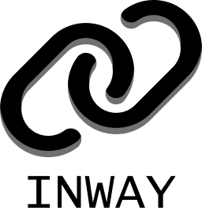

 

**INWAY is a tool for helping people with their own PCs. Use it only on PCs you own, or where the owner and the person using that PC agreed to it.**

I wrote INWAY to help my family, friends and coworkers. A remote desktop can also be used to get into someone's PC without asking. That is not what INWAY is for, and I don't accept that use.

* **For:** helping someone who asked for help and sits at that PC.
* **For:** your own PCs, at home or at work.
* **For:** PCs and servers you manage, with the permission of whoever owns them, and with the people who use them knowing about it.
* **Not for:** getting into a PC without the permission of its owner.
* **Not for:** watching someone's screen without them knowing.
* **Not for:** hiding INWAY, its notice window or its service from the person at that PC.

---

## You are responsible

**Whoever runs INWAY decides which PC it connects to, and is responsible for that.**

Getting into a computer without permission is a crime in most countries. In Turkey it is article 243 of the Turkish Penal Code (TCK, "Bilişim sistemine girme"). Rules about personal data and about watching employees can also ask you to tell people before you see their screen. When you are not sure, ask them first, or ask a lawyer.

## How INWAY stays visible

* Without the code, the person at the PC has to click **Accept**.
* While someone is connected, a window in the corner says who it is and has a **Disconnect** button. Every kind of INWAY shows it, also the always-on server. Only when nobody is signed in to the PC (the login screen) there is nobody to show it to.
* Only an administrator of the PC can install the always-on server, and it shows in the Windows service list as **INWAY Remote Desktop**.
* The code changes every time INWAY starts, unless someone sets it with `-p`.
* It only works inside the local network, and only one person can be connected at a time.

## No warranty

INWAY is free software under the **[GPL-3.0](LICENSE)**. As sections 15 and 16 of that license say, it comes **"as is", without any warranty**, and I am not liable for any damage that comes from using it.

## Changed copies

The GPL lets anyone change INWAY and share it. Section 5 asks that a changed copy says it was changed, and when. **A changed copy is not mine, and I am not responsible for it**, above all one that hides what it does. My releases are only the ones on the **[Releases page][__RELEASES__]**, signed with my certificate.

> This page does not change the license. It says what INWAY is made for, and who is responsible for how it is used.

---

## Türkçe

**INWAY, insanlara kendi bilgisayarlarında yardım etmek için yapılmış bir araçtır. Yalnızca size ait olan ya da sahibinin ve onu kullanan kişinin izin verdiği bilgisayarlarda kullanın.**

* **Ne için:** yardım isteyen ve bilgisayarın başında olan birine yardım etmek; kendi bilgisayarlarınız; sahibinin izniyle ve kullananların bilgisi dahilinde yönettiğiniz bilgisayarlar ve sunucular.
* **Ne için değil:** bir bilgisayara izinsiz girmek, birinin ekranını haberi olmadan izlemek, INWAY'i, bildirim penceresini ya da hizmetini o kişiden gizlemek.
* **Bildirim:** biri bağlıyken köşedeki küçük pencere kimin bağlı olduğunu söyler ve **Bağlantıyı Kes** düğmesi vardır. Her zaman açık sunucu dahil, INWAY'in her türü bunu gösterir.
* **INWAY'i çalıştıran kişi hangi bilgisayara bağlanacağına kendisi karar verir ve bundan kendisi sorumludur.** Bir bilişim sistemine izinsiz girmek birçok ülkede suçtur; Türkiye'de Türk Ceza Kanunu'nun 243. maddesi ("Bilişim sistemine girme"). Kişisel verilerle ve çalışanların izlenmesiyle ilgili kurallar da, ekranlarını görmeden önce kişileri bilgilendirmenizi gerektirebilir.
* **Garanti yok:** INWAY, GPL-3.0 lisansıyla "olduğu gibi", hiçbir garanti olmadan verilir (lisansın 15. ve 16. bölümleri).
* **Değiştirilmiş kopyalar benim değildir** ve onlardan sorumlu değilim. Benim sürümlerim yalnızca [Releases sayfasındakiler][__RELEASES__], benim sertifikamla imzalı olanlardır.

[__RELEASES__]: https://github.com/Maximum-Tension/INWAY/releases
